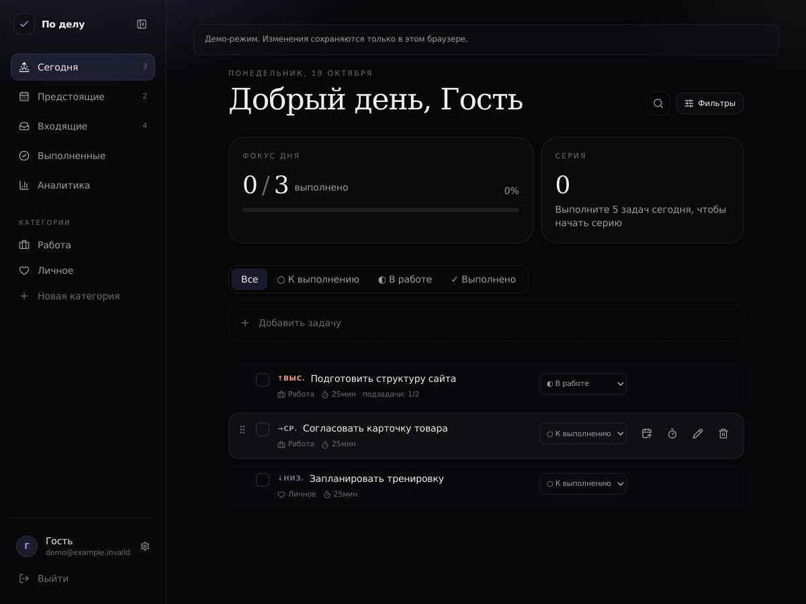

# По делу

Персональный трекер задач с приоритетами. Статусы: к выполнению, в работе, выполнено. Приоритеты: низкий, средний, высокий. Список фильтруется на сервере по `?status=`. Неделя начинается с понедельника. Удалённую задачу можно вернуть вместе с датами и подзадачами.

```text
frontend/  React + TypeScript + Vite + Axios + Zustand
backend/   NestJS + Prisma + PostgreSQL + JWT
```

## Посмотреть приложение

На странице входа есть кнопка **«Посмотреть демо»**. В демо уже созданы задачи и подзадачи: можно менять сроки, статусы, категории, удалять и восстанавливать задачи. Все изменения остаются только в этом браузере. Демо не обращается к серверу и не использует реальные учётные записи.



## Запуск

```bash
cp .env.example .env
cp frontend/.env.example frontend/.env
cp backend/.env.example backend/.env

npm run install:all
docker compose up --build
npm run dev:frontend
```

Frontend: http://localhost:5173  
API: http://localhost:3000/api  
Swagger: http://localhost:3000/api/docs

Корневой `.env` нужен только Docker Compose (`JWT_SECRET`, `JWT_EXPIRES_IN`, `CORS_ORIGIN`).  
`VITE_API_URL` читает Vite из `frontend/.env`.

## Проверка

```bash
npm run typecheck
npm run lint
npm run test
npm run test:e2e
npm run build
```

## Деплой

Frontend — GitHub Pages (`HashRouter`, workflow `.github/workflows/deploy.yml`).  
Backend и PostgreSQL — отдельный сервер через Docker Compose.  
В Settings → Pages выберите источник **GitHub Actions**. После объединения изменений в `main` workflow соберёт и опубликует frontend. Без `VITE_API_URL` публикуется версия только с демо-входом - отдельный сервер для просмотра портфолио не нужен.

Чтобы включить настоящие аккаунты, разместите API и PostgreSQL, задайте GitHub variable `VITE_API_URL` (HTTPS-адрес с `/api`) и разрешите адрес Pages в `CORS_ORIGIN` серверной части. Секрет JWT и строка подключения остаются только на сервере. Следующая сборка включит регистрацию и вход.

`check.yml` проверяет frontend и backend. Для E2E он поднимает отдельный PostgreSQL и применяет миграции.
